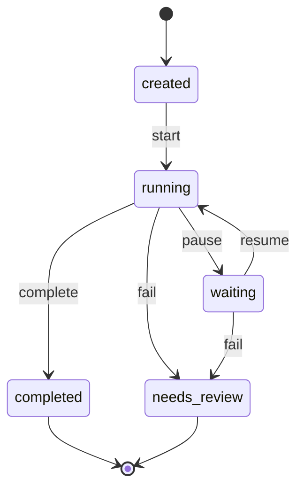
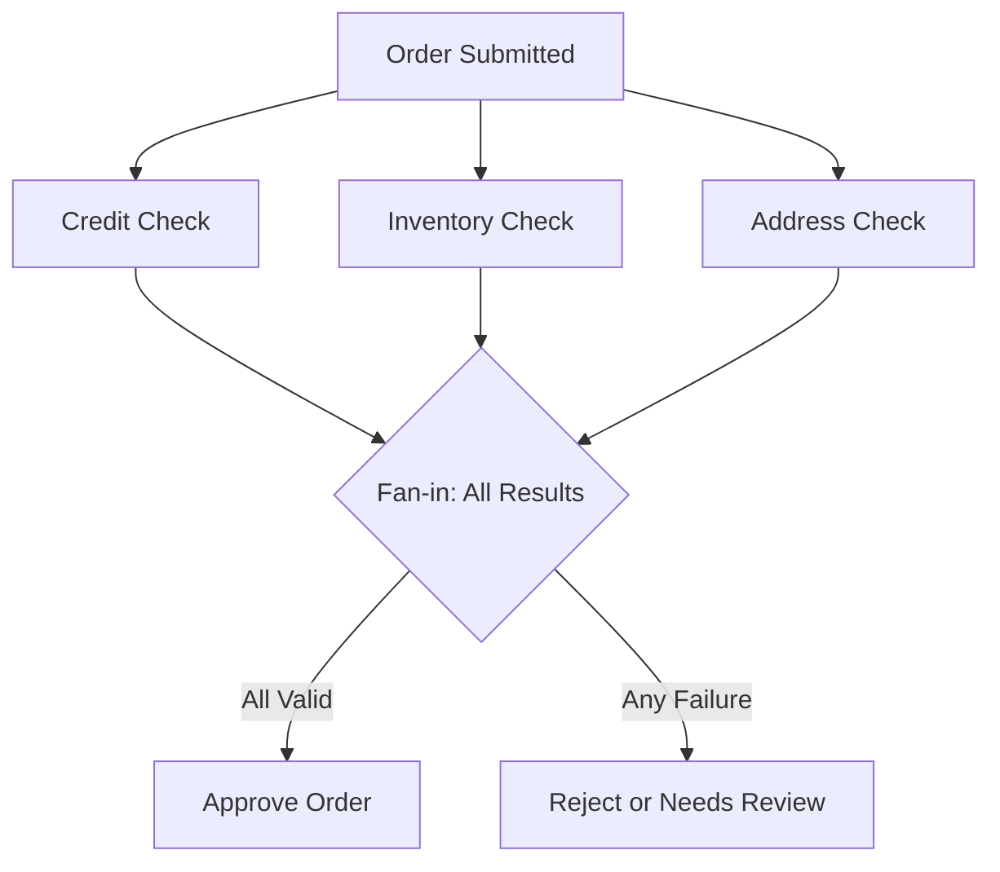

# Parallel Workflow State Transition Model

## Workflow States

| Current state | Event | Next state | Meaning |
|---|---|---|---|
| created | start | running | Workflow execution begins |
| running | complete | completed | All required workflow activities succeeded |
| running | pause | waiting | Workflow is waiting for an external condition |
| waiting | resume | running | Workflow resumes |
| running | fail | needs_review | Workflow requires operator review |
| waiting | fail | needs_review | Waiting workflow requires operator review |

## State Diagram

## Parallel Check Design

The order workflow contains three independent checks:

- Credit check
- Inventory check
- Address check

All three checks are prerequisites for the approval task.

The parallel execution mechanism will be implemented in Task 2.
